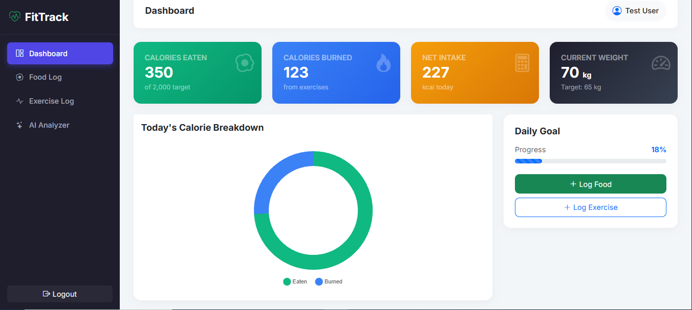
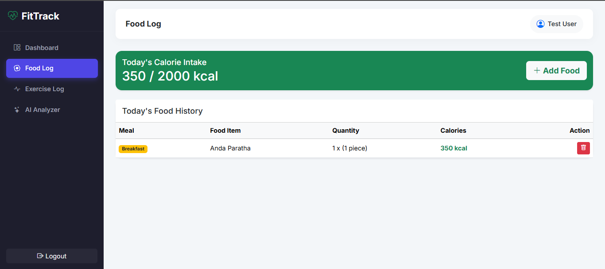
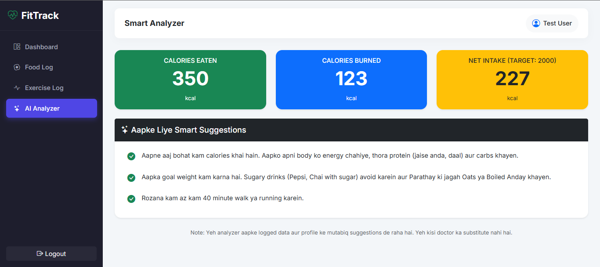

# 🏋️ FitTrack - Personal Health & Fitness Tracker

A modern, full-stack health and fitness tracking web application built with Laravel 11 and Bootstrap 5. FitTrack helps users log their daily food intake, track exercises, and get smart suggestions to reach their fitness goals.


## 📸 Screenshots

### Modern Dashboard & Analytics


### Dynamic Food Logging (Multiple Items)


### Smart AI Analyzer


---

## 🚀 Key Features

- **Dynamic Food Logging:** Log multiple food items at once with a dynamic form. Comes with a pre-seeded database of 40+ Pakistani foods with accurate calorie counts.
- **Smart Exercise Tracker:** Log exercises (Walking, Running, Gym, etc.) and let the system automatically calculate calories burned using the standard MET formula based on user weight.
- **AI Analyzer (Rule-Based):** Analyzes daily food intake and exercise to provide personalized suggestions for weight loss, gain, or maintenance.
- **Modern Interactive Dashboard:** Beautiful UI with Doughnut charts (Chart.js), progress bars, and daily calorie summaries.
- **User Profiles:** Stores user height, weight, target weight, and daily calorie goals to personalize the experience.
- **Responsive UI:** Fully responsive split-screen authentication and a modern mobile-friendly sidebar layout.

## 🛠️ Tech Stack

- **Backend:** Laravel 11 (PHP 8.2)
- **Database:** MySQL
- **Frontend:** Bootstrap 5, Chart.js, Vanilla JavaScript
- **Authentication:** Laravel Breeze

## ⚙️ Installation & Setup

1. Clone the repository:
   ```bash
   git clone https://github.com/ahmadlashari55/fittrack.git
   cd fittrack